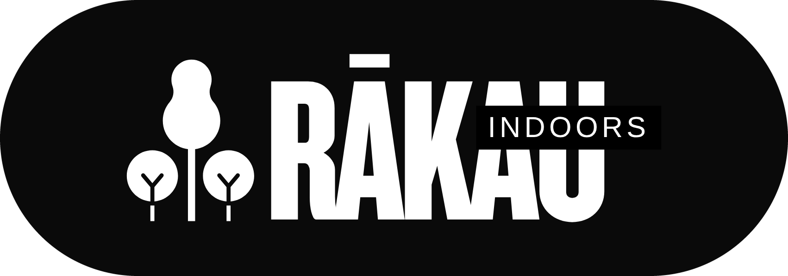

# Rākau Indoors Website

The purpose of this github repo is to provide a collaborative space to work on a fully functional prototype of the Rākau Indoors website with functional hiking videos. 

The site will consist of five pages. 

- walks.html
- about.html
- gallery.html
- index.html
- contact.html

## Authors

- [@jamesleviwesty](https://github.com/jamesleviwesty)
- [@brandoncook642-cmd](https://github.com/brandoncook642-cmd)
- [@NEOSYNTHETICA](https://github.com/NEOSYNTHETICA)
- [@CodingNabbs](https://github.com/CodingNabbs)

## Who did what

Shout-outs, straight from the commit history (as of 15 Oct 2026).

**[@jamesleviwesty](https://github.com/jamesleviwesty)** (me)
- Set up the repo, this README and the to-do list
- Renamed Overview to About, made the Walks page, tidied and commented everything
- SVG logo, WebP backgrounds, mobile menu fixes, and the day/night ripple
- Gave the whole site the Apple-ish glow-up, sticking to the A2 brief's black and white look
- About page: the Taranaki hero (day and night versions), "How a walk works", and the "Get to know us" boxes (plus the honesty box, you're welcome)
- The "Choose a walk" carousel on Walks and Gallery: arrows, dots, keyboard, swipe, the lot
- The "Say hello." contact form
- Moved the English / te reo switch into the nav and translated the whole site (draft te reo, still needs checking by someone fluent)
- Accessibility stuff: alt text everywhere, keyboard support, reduced motion, works down to 320px
- Fixed the bits that broke in merges

**[@brandoncook642-cmd](https://github.com/brandoncook642-cmd)**
- First About page and the accordion idea
- Homepage hero work and the homepage photos
- That glowing "Rākau Indoors" on the homepage
- The eight Waikato gallery photos
- The original English / te reo switch on the homepage (the one that kicked off the site-wide version)
- Set up our YouTube, Instagram and Facebook and hooked them up in the footer

**[@CodingNabbs](https://github.com/CodingNabbs)**
- Homepage styling
- The slim see-through footer
- Bigger, easier-to-tap nav links

**[@NEOSYNTHETICA](https://github.com/NEOSYNTHETICA)**
- Photo cred on the gallery: Neosynthetica GigaCorp, our very serious photography division

## Badges

# Rākau A3 To-Do List

COMP506 Interactive Digital Media/Assessment 3 is worth 35% of final grade

Our Job is to deliver the Rākau virtual hiking website, three interactive videos, and a group presentation.

**Mark Sheet**

| Section | Marks |
|---|---|
| Interactive Digital Videos (3 videos) | 25 |
| Client feedback | 12 |
| Design elements | 10 |
| HTML, CSS & JavaScript code | 10 |
| Social media | 8 |
| Accessibility | 8 |
| Navigation, links & hosting | 7 |
| Home, FVPP, About, Other pages (5 each) | 20 |
| **Total** | **100** |

---

## 1. Client feedback (12 marks)

- [ ] Review the A2 feedback from the client (tutor)
- [ ] Make a table: feedback point → what we changed → where on the site
- [ ] Make a mind map of our thought process *(this is needed for an A)*
- [ ] Make before/after illustrations: A2 design next to the final site *(this is also needed for an A)*
- [ ] Be ready to explain how the feedback shaped the final design

## 2. Website pages (20 marks)

- [x] Rename **Overview > About** and add a **Walks (FVPP)** page (@jamesleviwesty)
  - *Note: `overview.html` was renamed to `about.html` with `git mv`, so its history is kept. `walks.html` is a blank page shell, ready for the video previews.*
- [x] Update the nav and footer links on every page to match (@jamesleviwesty)
  - *Note: The header and footer are copy-pasted into every page. If you change a link, change it on all five pages.*
- [x] **Home**: makes clear it's virtual hiking within a 5-second glance, uses columns, links to the FVPP (@jamesleviwesty, @brandoncook642-cmd, @CodingNabbs)
  - *Note: Hero, then three columns saying what it is ("Real native bush", "At your own pace", "Open to everyone"), a featured walk card and a gallery teaser. The hero button and "See all walks" both go to `walks.html` (the FVPP).*
- [ ] **Feature Video Products Page (FVPP)**: video previews with interactive elements (click to play, filters, pop-up player)
  - *Note: The "Choose a walk" carousel is built (arrows, dots, keyboard, swipe, play badges). Still to do: the three real videos, click to play, and the player.*
- [x] **About**: company story and culture (meaning of Rākau, te reo), uses columns (@jamesleviwesty, @brandoncook642-cmd)
  - *Note: Mission, "What we offer", "Why Rākau?" and "How a walk works" in the A2 three-column layout.*
- [x] **Gallery**: completed with content (@brandoncook642-cmd photos, @jamesleviwesty carousel)
- [x] **Contact**: completed with a form and social links (@jamesleviwesty, @brandoncook642-cmd)
  - *Note: The form isn't connected to anything yet. It checks the fields and says thanks, but nothing is sent. Hook it up (Formspree or Netlify Forms) before we say it works.*
- [x] Every page communicates culture and content
  - *Note: Every page switches between English and te reo Māori. The te reo is a draft: get a fluent speaker to check it.*

## 3. Design elements (10 marks)

- [x] Clear visual hierarchy on every page (headings, spacing, emphasis)
- [x] Colour is used consistently and matches our A2 design brief
  - *Note: The A2 brief asks for high-contrast black and white, "clarity over decoration", so the greyscale is on brand. The colour comes from the photos.*
- [ ] Media (images, video) on every page
  - *Note: Home, About, Walks and Gallery have photos. Contact doesn't yet.*
- [x] Interactions are consistent across pages (hovers, buttons, menus)
  - *Note: Every animation uses the same few speeds and curves, set once at the top of `styles.css`.*
- [x] Layout feels balanced and consistent from page to page

## 4. Navigation, links & hosting (7 marks)

- [x] Menu navigation visible on every page
- [x] Mobile menu works
  - *Note: Fixed the menu getting stuck when the window is widened with it open, and the logo overlapping the theme toggle on phones.*
- [ ] Every link works: check each page on desktop and phone, in light and dark mode
  - *Note: Every internal link, anchor and image path has been checked and resolves. Still worth one manual click-through on a phone.*
- [x] Extra links that help users move around (buttons, back-to-top, links between pages)
  - *Note: Back-to-top on every page, the homepage button to Walks, "See how it works" and "Choose a walk" on About.*
- [ ] **Site is hosted online** (an unhosted site can't score above 3/7)
  - *Note: Easiest option is GitHub Pages: repo Settings → Pages → Deploy from `main` / root.*

## 5. Social media (8 marks)

- [x] YouTube channel (hosts the videos) (@brandoncook642-cmd)
- [x] Second platform: Instagram (@brandoncook642-cmd)
- [x] Third platform: Facebook *(needed for an A)* (@brandoncook642-cmd)
- [x] Social icons in the footer on every page (@jamesleviwesty)
  - *Note: Social media links are up and running, and point at our real accounts (@brandoncook642-cmd).*

## 6. Accessibility (8 marks)

- [x] Colour preference selector (light/dark tree toggle) *(needed for an A)*
  - *Note: Switching theme now ripples out from the toggle. People with "reduce motion" turned on get an instant switch instead.*
- [x] Skip-to-content link
- [x] Alt text on every image (@jamesleviwesty)
  - *Note: Every image on every page now has alt text describing what's in it, in English and te reo. The homepage backgrounds are CSS decoration, so they don't need any.*
- [x] Te reo Māori marked with `lang="mi"` so screen readers pronounce it properly (@jamesleviwesty)
  - *Note: Done site-wide. The language switch marks every te reo word, label and alt text `lang="mi"`.*
- [x] English / te reo Māori switch in the nav, remembered across pages (@brandoncook642-cmd's idea, @jamesleviwesty site-wide)
- [x] Keyboard support everywhere: menus, carousels (arrow keys), the About sections, the form
- [x] Reduced motion respected: every animation becomes instant
- [ ] `title` on every embedded video
- [x] `aria-label` on every icon-only link (@jamesleviwesty)
  - *Note: Logo links and social icons are covered. Check any new icon-only links.*
- [ ] Check colour contrast in both themes (WebAIM Contrast Checker)

## 7. HTML, CSS & JavaScript code (10 marks)

- [x] Every file indented correctly (VS Code: **Shift+Alt+F**) (@jamesleviwesty)
- [x] Comments in the HTML, CSS and JS (@jamesleviwesty)
  - *Note: Every file now has comments explaining why the code is the way it is. Some comments also point out unfinished jobs (social URLs, brand colours, page content).*
- [x] Uses essential HTML, CSS and JavaScript elements
- [x] Tidy folders: `css/`, `js/`, `media/` (@jamesleviwesty)
  - *Note: `media/` has unused files to clear out before submission: `logotree.jpeg`, `image.png`, `NavLogo.png`, `treedark.*`, `treelight.*`, plus the full-size originals the site no longer loads: `bg3.jpg` (7MB), `bg4.jpg` and `Gallery 1-8.jpg` (8MB). The site uses the web-sized copies (`bg3-web.jpg`, `bg4-web.jpg`, `media/gallery/`). Check with the team first.*
- [ ] Each page passes the W3C validator

## 8. Interactive Digital Videos (25 marks)

- [ ] Watch the sample video on the Moodle A3 tab (it can count as one of our videos)
- [ ] Video 1 made to spec
- [ ] Video 2 made to spec
- [ ] Video 3 made to spec
- [ ] Annotations on **all 3** (text overlays added in the video editor)
- [ ] Extra information and interactive elements on **all 3** (cards, end screens, chapters, links)
- [x] All 3 uploaded to YouTube *Note: Videos have been uploaded by Sesastion*
- [ ] Videos previewed on the FVPP

## 9. Group presentation

- [ ] Book a presentation slot on Moodle
- [ ] Cover the client feedback, the website and the video previews
- [ ] Clear order: feedback → live site demo → videos → social media → questions
- [ ] Everyone presents an even share
- [ ] Rehearse
- [ ] Have a backup ready (local copy and screenshots) in case the internet drops

## 10. Group Declaration Survey

- [ ] **Every** member completes it after the presentation (it's on the A2 tab). Anyone who doesn't accepts an even split of marks

## 11. Our Final submission

- [ ] All website files
- [ ] All 3 videos
- [ ] `links.txt` with the hosted site, YouTube and social media URLs
- [ ] Everything in **one zip file**
- [ ] Unzip on another computer to check nothing is missing
- [ ] Upload to the Moodle A3 submission link

---

## Common mistakes to avoid [Sourced from the Wintec Page]

- Not showing how the A2 feedback was used
- Missing pages (Home, FVPP, About, other pages)
- FVPP with no interactive video previews
- Broken links or a site that isn't hosted
- Not enough social media (YouTube + 2 more for an A)
- Missing alt text or weak colour contrast
- Code not indented or no comments
- Fewer than 3 videos, or videos missing annotations or interactive elements
- Uneven speaking time in the presentation
- Skipping the Group Declaration Survey
- An incomplete zip file

